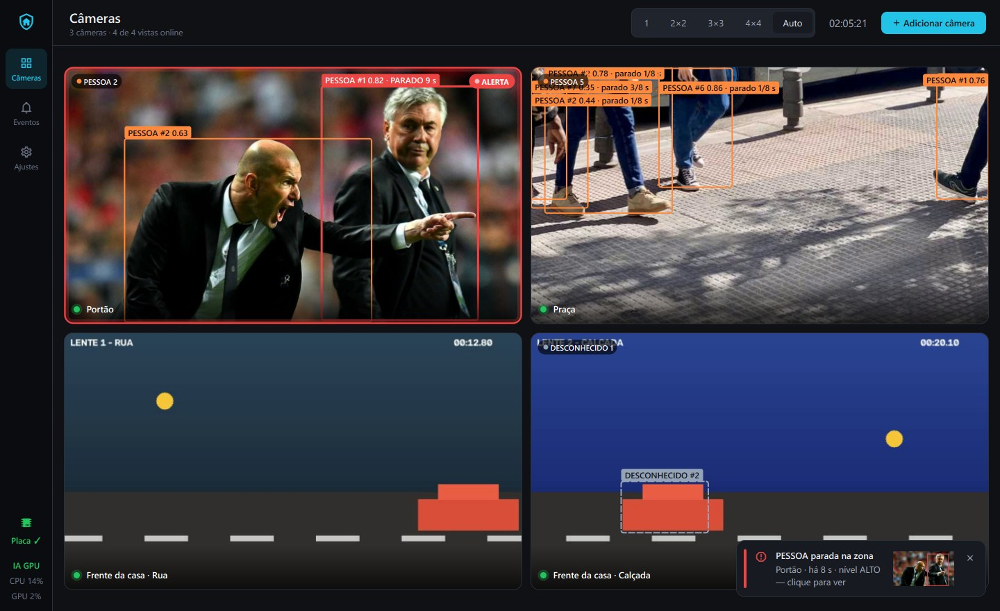
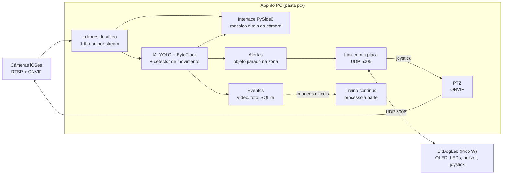
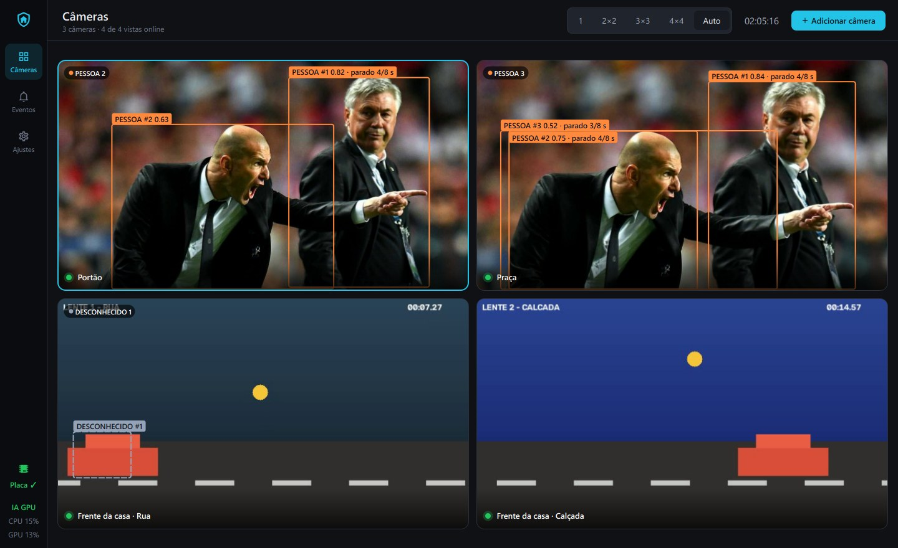
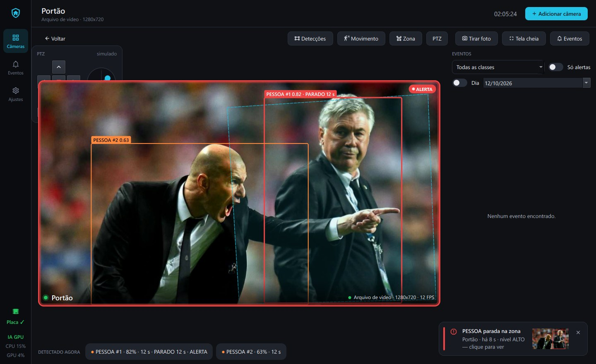
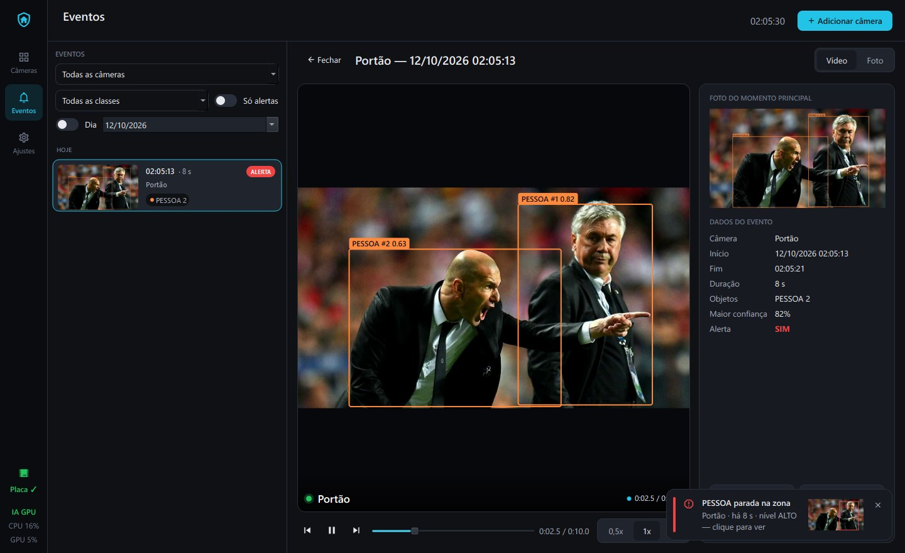
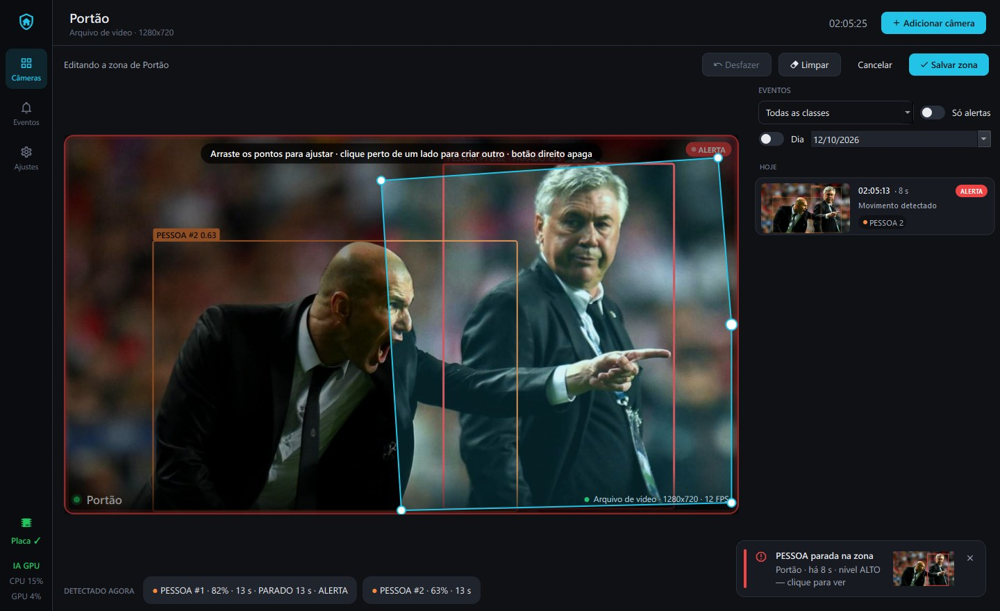
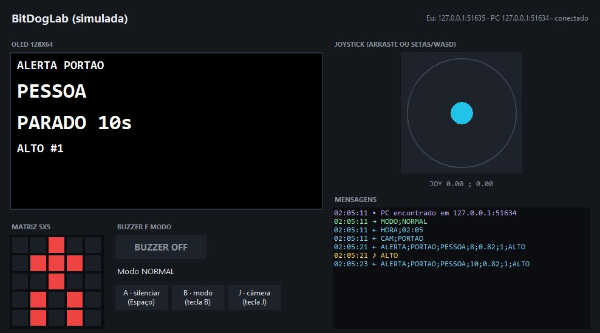
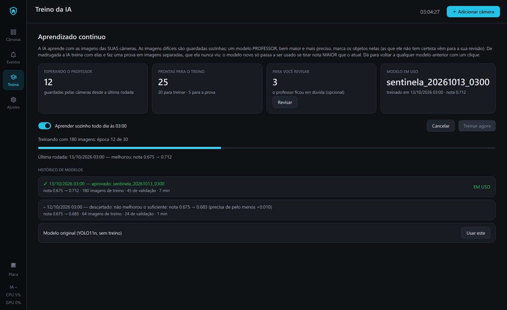
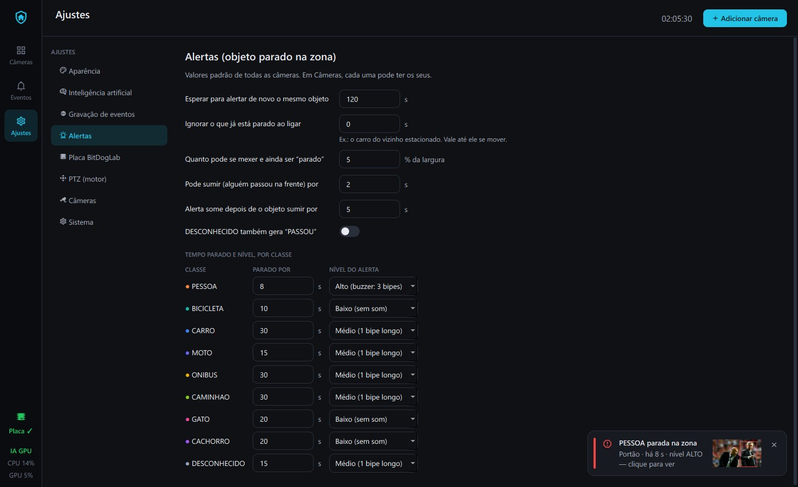

# Sentinela Casa

[](LICENSE)


-orange.svg)

Monitoramento residencial no estilo NVR/CFTV para câmeras Wi-Fi **iCSee (Xiongmai)**: vídeo ao
vivo, detecção e classificação de objetos com IA, gravação de eventos com foto e vídeo e **alerta
quando algo fica parado em frente à casa** — com aviso na placa **BitDogLab** (Raspberry Pi Pico W),
que também tem um joystick para girar a câmera.



O projeto tem duas partes:

| Parte | Pasta | Linguagem | Obrigatória? |
| --- | --- | --- | --- |
| App do PC (vídeo, IA, eventos, alertas, PTZ, treino) | [`pc/`](pc/) | Python 3.11+ (PySide6, OpenCV, Ultralytics YOLO) | sim |
| Firmware da placa BitDogLab | [`bitDogLab/`](bitDogLab/README.md) | C (Raspberry Pi Pico SDK 2.3.1) | não — sem a placa, use o simulador |

## Índice

- [O que ele faz](#o-que-ele-faz)
- [Como funciona](#como-funciona)
- [O que você precisa](#o-que-você-precisa)
- [Instalação](#instalação)
- [Teste rápido, sem câmera nenhuma](#teste-rápido-sem-câmera-nenhuma)
- [Primeiros passos com uma câmera de verdade](#primeiros-passos-com-uma-câmera-de-verdade)
- [Usando](#usando) — mosaico, tela da câmera, eventos, zona e alertas, PTZ, placa, treino, ajustes
- [Onde ficam as coisas](#onde-ficam-as-coisas)
- [Ferramentas](#ferramentas)
- [Solução de problemas](#solução-de-problemas)
- [Testes automatizados](#testes-automatizados)
- [Estrutura do repositório](#estrutura-do-repositório)
- [Documentação](#documentação)
- [Licença e créditos](#licença-e-créditos)

## O que ele faz

- **Ao vivo:** mosaico de câmeras (leve) e Tela da câmera em resolução máxima.
- **IA (YOLO):** identifica PESSOA, BICICLETA, CARRO, MOTO, ONIBUS, CAMINHAO, GATO e CACHORRO;
  movimento sem objeto reconhecido vira DESCONHECIDO. Cada objeto ganha um número (rastreamento).
- **Eventos:** movimento ou objeto novo → um vídeo curto (com alguns segundos de antes), a foto do
  melhor momento e as detecções. Lista por dia, filtros e player com as caixas desenhadas.
- **Alertas:** objeto **parado** dentro da zona que você desenhou (PESSOA 8 s, MOTO 15 s, CARRO 30 s…)
  → notificação, borda vermelha e aviso na placa (OLED, matriz de LED e buzzer).
- **Placa BitDogLab:** recebe os alertas por Wi-Fi (UDP) e manda o joystick e os botões. Sem a placa,
  use o **simulador** (outra janela, até em outro computador).
- **PTZ:** gire a câmera pela tela, pelas setas do teclado ou pelo joystick da placa.
- **Câmeras de duas lentes** (ex.: iCSee XM232, que manda as duas imagens empilhadas): cada lente
  vira um bloco separado, com zona e eventos próprios.
- **Aprendizado contínuo:** a IA aprende sozinha com as imagens das SUAS câmeras e só troca de
  modelo quando o novo é comprovadamente melhor (dá para voltar com um clique).

## Como funciona



1. **Captura:** cada câmera tem um leitor numa thread própria, que guarda só o quadro mais recente
   (nada acumula se o PC atrasar). O mosaico usa o **substream** (leve); a Tela da câmera abre o
   stream **principal** (resolução máxima).
2. **IA:** uma única instância do YOLO atende todas as câmeras em rodízio (em lote, na placa de vídeo
   se houver). Cada câmera/lente tem o próprio rastreador (ByteTrack), que dá um número a cada objeto;
   um detector de movimento (MOG2) acha o que se mexe sem ser reconhecido (DESCONHECIDO).
3. **Eventos e alertas:** os resultados da IA abrem eventos (vídeo + foto + banco SQLite) e alimentam
   a regra "parado na zona", que gera ALERTA / LIMPAR / PASSOU.
4. **Placa:** os alertas vão por UDP para a BitDogLab (ou o simulador); o joystick e os botões voltam
   pelo mesmo caminho. O protocolo é texto simples, descrito em [docs/protocolo.md](docs/protocolo.md).
5. **Interface:** nunca trava — captura, IA, gravação e rede rodam fora da thread da janela, e os
   quadros chegam a ela por sinais do Qt.

## O que você precisa

| Item | Detalhes |
| --- | --- |
| Computador | Windows ou Linux com **Python 3.11 ou mais novo** (desenvolvido e testado no Windows 10 com Python 3.14) |
| Placa de vídeo NVIDIA | opcional, mas recomendada: a IA fica muito mais leve. Sem ela, a IA roda no processador. O treino contínuo precisa dela |
| Câmeras | iCSee/Xiongmai ou qualquer câmera **RTSP** que o PC alcance pela rede. Para testar sem câmera: vídeos `.mp4` ou a webcam |
| Placa BitDogLab | opcional: Raspberry Pi Pico W no Wi-Fi de **2,4 GHz**. Sem ela, use o simulador (só Python) |
| Internet | só na primeira vez, para o `pip install` e para baixar os pesos do YOLO (~6 MB; o "professor" do treino, ~110 MB, só quando o treino rodar) |

Câmera usada no desenvolvimento: iCSee **XM232_X6S-WEQ-H_8M** (duas lentes empilhadas numa imagem, com
motor). Outras câmeras RTSP também servem: no cadastro há o modelo de URL "ONVIF genérico" e o
"Personalizado"; dá para acrescentar modelos em `pc/config.yaml` → `modelos_url`.

## Instalação

```bash
# 1. Baixe o projeto
git clone https://github.com/DiegoSousaOliveira/manitoramento_cmr_BitDogLab.git
cd manitoramento_cmr_BitDogLab

# 2. Crie um ambiente virtual (fica na pasta .venv, fora do Git)
python -m venv .venv
.venv\Scripts\activate             # Windows
# source .venv/bin/activate        # Linux

# 3. (Opcional, placa de vídeo NVIDIA) instale ANTES o PyTorch com CUDA — o comando certo para o
#    seu sistema está em https://pytorch.org/get-started/locally/ . Placas RTX 50xx precisam de
#    CUDA 12.8 ou mais novo, por exemplo:
#   pip install torch torchvision --index-url https://download.pytorch.org/whl/cu130

# 4. Instale as dependências do app
pip install -r pc/requirements.txt
```

Sem o passo 3, o `pip` instala o PyTorch que roda só no processador (funciona, mas a IA fica mais
pesada). O modelo de IA (~6 MB) é baixado sozinho na primeira vez, para `pc/modelos/`.

**Linux:** além do Python, instale o Tkinter (só para o simulador da placa) e a biblioteca que o Qt
usa para o cursor — no Ubuntu/Debian: `sudo apt install python3-venv python3-tk libxcb-cursor0`. As
senhas das câmeras vão para o cofre do sistema (GNOME Keyring ou KWallet), que precisa estar
disponível na sessão.

## Teste rápido, sem câmera nenhuma

Dá para ver o app funcionando de ponta a ponta só com vídeos gerados e o simulador da placa:

```bash
cd pc
python tools/gerar_video_teste.py --pessoas      # cria videos/pessoas.mp4 (pessoas e um ônibus)
python tools/gerar_video_teste.py --duas-lentes  # cria videos/duas_lentes.mp4 (duas lentes empilhadas)
python main.py                                   # abre o app
```

1. No app, **Adicionar câmera** → Fonte do vídeo: **Arquivo de vídeo** → escolha *Pessoas e ônibus* →
   dê um nome e um código (ex.: `TESTE`) → **Salvar câmera**. Em segundos aparecem as caixas com
   PESSOA e ONIBUS, e a aba **Eventos** começa a receber vídeos (o vídeo de teste passeia sobre as
   fotos, então tudo "se mexe").
2. Para ver um **alerta**, é preciso algo que fique PARADO — a webcam é o jeito mais fácil:
   **Adicionar câmera** → **Webcam** → **Salvar câmera**. Clique no bloco dela → **Zona** → clique nos
   cantos de uma área que pegue você → **Salvar zona**. Espere uns 20 s (o que já está na imagem ao
   ligar é ignorado até se mexer), saia da frente, volte e fique parado na zona: em 8 s vem o
   **alerta** (notificação, borda vermelha e selo ALERTA no evento).
3. Em outro terminal (também dentro de `pc/`): `python tools/simulador_bitdoglab.py`. Ele mostra um IP
   e uma porta; no app, **Placa** (barra lateral) → digite esse IP → **Salvar e conectar**. Os alertas
   passam a aparecer no "OLED" e na "matriz de LEDs" do simulador.

## Primeiros passos com uma câmera de verdade

1. De dentro da pasta `pc/`: `python main.py`.
2. Clique em **Adicionar câmera**. Preencha nome, IP, usuário e senha e clique em **Testar conexão**
   — aparece a imagem ao vivo e um diagnóstico em português se algo der errado (senha, porta...).
   A senha vai para o **cofre de senhas do sistema** (nunca para um arquivo).
3. Câmera com duas lentes numa imagem só? Em "Lentes dentro da imagem" escolha **Duas lentes
   empilhadas** (o teste de conexão sugere isso sozinho) e dê nomes às vistas (ex.: Rua, Calçada).
4. Câmera com motor? Marque **possui motor (PTZ)** e escolha **qual lente o motor move**.
5. O **código para a placa** (ex.: `FRENTE`, até 10 letras/números) é o que aparece no display da BitDogLab.

Não sabe o IP da câmera? Ele aparece no app iCSee (configurações do dispositivo) ou na lista de
aparelhos conectados do roteador. O app **não** faz varredura da rede de propósito: você cadastra as
câmeras que são suas.

## Usando

### Mosaico



- **Clique** num bloco: abre a Tela da câmera. **Duplo clique**: já em tela cheia.
- **Botão direito**: editar, tirar foto, ligar/desligar a detecção, reconectar, remover.
- Layout no topo (1, 2×2, 3×3, 4×4, Automático); com muitas câmeras aparecem páginas.
- Chips no canto ("PESSOA 2"), caixas coloridas por classe, e o status da câmera (verde online,
  amarelo conectando, cinza offline com o motivo e o botão **Reconectar**).

### Tela da câmera



- Vídeo em **resolução máxima** (enquanto ela carrega, aparece o substream com o selo
  "Carregando alta resolução…"). Ao sair da tela, a conexão de alta resolução é encerrada (a não ser
  que a IA esteja usando a imagem HD).
- Duas lentes: abas **Todas | Rua | Calçada**.
- Botões: **Detecções** (caixas), **Movimento** (o que o detector de movimento vê), **Zona**,
  **PTZ**, **Tirar foto** (na resolução máxima), **Tela cheia**, **Eventos** (lista ao lado).
- Faixa **Detectado agora**: cada objeto com número, confiança, há quanto tempo está na cena e o
  contador "parado 6/8 s".

### Eventos



- Aba **Eventos** (barra lateral): todas as câmeras, agrupadas por dia, com filtros por câmera, classe,
  "Só alertas" e dia. Na Tela da câmera, o painel lateral mostra só os daquela câmera.
- Clique num evento: o vídeo toca com as caixas (play/pausa, linha do tempo, 0,5×/1×/2×, quadro a
  quadro), a foto aparece ao lado. **Abrir pasta**, **Exportar** (salva o `.mp4` e a foto onde você
  quiser) e **Excluir**. **Esc** volta ao vivo.
- Ficam em `pc/dados/eventos/<câmera>/<data>/<hora>/`. Os mais velhos que o limite (7 dias) ou que
  passam do espaço máximo (20 GB) são apagados sozinhos — tudo ajustável em **Ajustes → Gravação**.
- Por padrão, qualquer movimento na imagem abre evento. Para gravar só o que acontece dentro da zona:
  Ajustes → Gravação → **Onde o movimento abre evento: Só dentro da zona**.

### Zona e alertas (objeto parado)



- Na Tela da câmera, **Zona**: clique para marcar os cantos, arraste para ajustar, botão direito
  apaga um ponto; **Salvar zona**. Desenhe a zona deixando de fora árvores e sombras que balançam
  (elas viram DESCONHECIDO).
- A zona vale **só para a lente em que foi desenhada**. Uma lente **sem zona não gera alertas**
  (Ajustes → Alertas → "Lente sem zona desenhada" muda isso para "vigia a imagem inteira"). Com
  "Só dentro da zona" nos eventos, vale a mesma regra.
- **Quais objetos:** em Ajustes → Inteligência artificial → "Objetos que a IA identifica", desmarque o
  que não interessa (some da tela, dos eventos e dos alertas). Em Ajustes → Alertas, a coluna
  **ALERTA** diz quais classes alertam na zona (as outras só aparecem na tela). Desligar
  **DESCONHECIDO** acaba com os alertas de folhas, sombras e chuva.
- Objeto dentro da zona mostra "parado 6/8 s". Passou do tempo → **alerta**: notificação vermelha com
  a foto (clique para ver o evento), borda vermelha pulsando, selo **ALERTA** no evento e aviso na placa.
- Um alerta por objeto (o mesmo só alerta de novo depois de 2 min). O que já estava parado quando a
  câmera ligou — o carro do vizinho — não alerta, até se mover.

### Mover a câmera (PTZ)

- Painel **PTZ** no canto do vídeo: **segure** uma seta para girar, solte para parar (■ para na hora).
  As **setas do teclado** fazem o mesmo. O círculo mostra a direção pedida.
- **Joystick da placa** (ou do simulador): move a câmera aberta na tela — no mosaico, a última
  selecionada. O botão **J** troca entre as câmeras com motor.
- **Posições**: "Salvar a posição atual como 1…4" / "Ir para a posição…". Dica: salve na 1 a posição em
  que você desenhou a zona, para voltar a ela depois de olhar em volta.
- Segurança: câmera andando sem comando por 3 s para sozinha. Girou para o lado contrário? Ajustes →
  PTZ (ou Ajustes → Câmeras, só para aquela câmera) → **Inverter**.

### Placa BitDogLab e o simulador



Como a placa e o PC se encontram:

1. A placa liga no Wi-Fi e mostra no display **AGUARDANDO PC**, o **IP** e a **porta** dela.
2. No app, clique em **Placa** (barra lateral) → digite o IP → **Salvar e conectar**.
3. O app chama a placa a cada 2 s; o display passa para **MONITORANDO** e a barra lateral mostra
   **Placa ✓** em verde. A placa não precisa saber o IP do PC (ela responde para quem a chamou) —
   por isso funciona até com o PC atrás de outro roteador.

Sem a placa, use o simulador — no mesmo computador ou em outro (ex.: um notebook). É um arquivo só:
copie `pc/tools/simulador_bitdoglab.py` (precisa de Python 3.10+ com Tkinter, que já vem no
instalador do python.org) e rode `python simulador_bitdoglab.py`. Joystick: arraste a bolinha ou
setas/WASD. Botões: **Espaço** = A (**1 toque** liga/desliga o mudo; **2 toques rápidos** calam o
alerta atual), **B** = modo NORMAL/NOITE (NOITE = sem som), **J** = próxima câmera com motor. Em
Ajustes → Placa BitDogLab: o **buzzer** (toca uma vez ou até o alerta acabar) e o **manual da placa**.

Para a placa de verdade (gravar o firmware, Wi-Fi, pinos): [bitDogLab/README.md](bitDogLab/README.md).
O protocolo está em [docs/protocolo.md](docs/protocolo.md).

### Treino da IA (aprendizado contínuo)



A IA aprende com as imagens das suas câmeras, sozinha:

1. **Coleta:** o app guarda as imagens difíceis (a IA ficou em dúvida, algo se mexeu sem ser
   reconhecido) e algumas comuns, de dia e de noite.
2. **Professor:** um modelo bem maior e mais preciso (YOLO11x, só usado no treino) marca os objetos
   nessas imagens. Se ele ficar em dúvida em alguma, ela vai para **a sua revisão** (opcional) e não
   entra no treino — um objeto sem caixa ensinaria a IA a ignorá-lo.
3. **Treino:** todo dia às 03:00 (ajustável), se houver imagens novas suficientes, a IA treina na
   placa de vídeo a partir do modelo atual. Leva poucos minutos e a IA continua funcionando.
4. **Prova:** o modelo novo e o atual são testados nas mesmas imagens de **validação**, que nunca
   entram no treino — nem para escolher "a melhor época": o treino roda um número fixo de épocas sem
   olhar para elas, e a prova final é a primeira vez que o modelo novo as vê. O novo só passa a ser
   usado se tirar nota **maior** e nenhuma classe piorar.
5. **Histórico:** cada rodada mostra a nota antes → depois e por que o modelo foi aprovado ou
   descartado. **Usar este** volta (ou avança) para qualquer modelo aprovado, ou para o original.

Na página **Treino**: **Treinar agora** (não espera a madrugada), **Revisar** (aceite com Enter,
desenhe caixas arrastando, troque a classe com as teclas 1–8, Del apaga, D descarta) e o liga/desliga
do aprendizado automático. Por que não "aprender com as próprias respostas"? Porque a IA reforçaria
os próprios erros — o que ela não enxerga nunca viraria exemplo. Por isso o professor e a prova.

O treino roda num processo separado, com prioridade baixa, e precisa de uns **7 GB de memória livre**
(veja [Solução de problemas](#solução-de-problemas)).

### Ajustes



Tudo o que dá para configurar, sem abrir arquivo nenhum: **Aparência**, **Inteligência artificial**
(modelo, onde a IA roda, imagem analisada, sensibilidade, exportar para CPU), **Gravação de eventos**
(tempos, qualidade, retenção, espaço em disco e "Limpar agora"), **Alertas** (tempo parado e nível por
classe), **Placa BitDogLab**, **PTZ**, **Câmeras** (cada câmera pode ter os próprios valores — campo
vazio usa o padrão) e **Sistema** (detalhe do log, pasta de dados).

Mudou algo? Aparece embaixo **Alterações não salvas → Salvar**: vale **na hora**, sem reiniciar (só a
pasta de dados precisa de reinício). Os valores ficam em `pc/config.yaml`, que continua editável à
mão e mantém os comentários. O `config.yaml` do repositório vem com os valores padrão (modelo
`yolo11n.pt`, 6 análises por segundo, IA na placa de vídeo se houver, treino às 03:00).

### Atalhos

| Onde | Atalho | Faz |
| --- | --- | --- |
| Mosaico | clique / duplo clique / botão direito | abrir câmera / tela cheia / menu |
| Qualquer tela | **F11** | tela cheia do app |
| Tela da câmera | **Esc** | sai da tela cheia, depois volta ao mosaico (ou do evento ao ao vivo) |
| Tela da câmera | **setas** | giram a câmera (com o painel PTZ visível) |
| Editor de zona | botão direito / **Esc** | apaga ponto / cancela |
| Revisão do treino | Enter · D · → · 1–8 · Del | aceitar · descartar · pular · classe · apagar caixa |
| Simulador | setas ou WASD · Espaço · B · J | joystick · silenciar · modo · câmera |

## Onde ficam as coisas

| O quê | Onde |
| --- | --- |
| Ajustes gerais | `pc/config.yaml` (também pela tela de Ajustes) |
| Câmeras, zonas e eventos | `pc/dados/sentinela.db` (SQLite) |
| Senhas das câmeras | cofre do sistema (Gerenciador de Credenciais / GNOME Keyring) — **nunca** em arquivo |
| Vídeos e fotos dos eventos | `pc/dados/eventos/<câmera>/<data>/<hora>/` |
| Fotos tiradas na mão | `pc/dados/fotos/<câmera>/<data>/` |
| Imagens do treino da IA | `pc/dados/treino/` (`pendentes/`, `rotuladas/`, `revisar/`, `historico.json`) |
| Modelos de IA (baixados e treinados) | `pc/modelos/` — os treinados se chamam `sentinela_AAAAMMDD_HHMM.pt` (os 10 mais novos) |
| Logs (para investigar problemas) | `pc/dados/logs/sentinela.log` e `treino.log` |

As pastas `pc/dados/`, `pc/modelos/` e `pc/videos/` são criadas pelo app e ficam **fora do Git**: as
imagens das suas câmeras nunca vão para o repositório.

## Ferramentas

De dentro da pasta `pc/`:

```bash
python tools/testar_camera.py --ip 192.168.0.50 --pedir-senha   # diagnóstico de UMA câmera
python tools/testar_camera.py --ip 192.168.0.50 --salvar-fotos  # grava um quadro de cada stream
python tools/gerar_video_teste.py [--duas-lentes | --pessoas]   # vídeos de teste em pc/videos/
python tools/simulador_bitdoglab.py                             # placa simulada
```

O `testar_camera.py` testa as portas 554 (RTSP), 8899 (ONVIF) e 34567 (DVRIP), abre o substream e o
stream principal (resolução, FPS, codec) e consulta o ONVIF (perfis e PTZ) — a mesma verificação do
botão **Testar conexão**. Sem câmera, cadastre um **Arquivo de vídeo** ou a **Webcam**.

## Solução de problemas

- **Câmera offline / "senha incorreta"**: use **Testar conexão** (ou o `testar_camera.py`): ele explica
  se é IP, porta, usuário/senha ou URL.
- **Alta resolução demora** (5–10 s no Wi-Fi): é normal; o substream aparece antes.
- **Vídeo ao vivo "engasgando"**: o Wi-Fi entrega os quadros em rajadas. Ajustes → Aparência →
  **Suavizar o vídeo ao vivo** (250 ms por padrão) deixa o vídeo fluido; aumente se ainda engasgar.
- **Objeto que já foi embora continua marcado / alerta sem nada na imagem**: com "Só analisar quando
  houver movimento", a IA confere os objetos a cada 2 s mesmo com a cena parada (Ajustes → IA). Para
  respostas mais rápidas, use mais "Análises por segundo" (3 a 5).
- **PC lento**: Ajustes → Inteligência artificial → **Imagem analisada: Substream**, menos análises por
  segundo, ou (sem placa de vídeo NVIDIA) exporte para **OpenVINO** e escolha **Processador (CPU)**.
- **Muitos DESCONHECIDO / alertas por folhas e sombras**: desenhe a **zona** sem as árvores e aumente
  o **tamanho mínimo do movimento** (Ajustes → IA, ou só naquela câmera).
- **Nenhum alerta aparece**: a lente precisa ter uma **zona** desenhada (ou mude Ajustes → Alertas →
  "Lente sem zona desenhada" para "vigia a imagem inteira").
- **A placa não conecta**:
  - confira o IP do display;
  - a placa precisa estar no Wi-Fi de **2,4 GHz**, fora da "rede de convidados";
  - libere o Python no **firewall do Windows** do computador do simulador (rede "Privada"; se ela
    estiver como "Pública", marque também "Redes públicas").
- **Câmera gira para o lado errado**: Ajustes → PTZ → Inverter (ou só naquela câmera).
- **"Não dá para treinar agora: pouca memória livre"** (ou o treino automático adiado no log): o treino
  da IA precisa de uns 7 GB de memória livre — a RAM **mais** o arquivo de paginação do Windows. Ele
  espera (tenta de novo a cada 30 min) e, se a memória ficar crítica no meio, para sozinho: as câmeras
  têm prioridade. Para sobrar espaço:
  - feche programas pesados enquanto treina (navegador, editor, jogos/Steam); ou
  - aumente o **arquivo de paginação**: Iniciar → "Exibir configurações avançadas do sistema" →
    Desempenho → **Configurações** → Avançado → Memória virtual → **Alterar** → desmarque "Gerenciar
    automaticamente" → unidade C: → **Tamanho personalizado**: inicial **24576** e máximo **32768** (MB)
    → Definir → OK → reiniciar o PC. Isso só reserva espaço no disco (até 32 GB); o PC não fica mais lento por isso.
  - Os limites ficam em Ajustes → Inteligência artificial ("Memória livre para começar o treino" e
    "Parar o treino se a memória livre cair abaixo de").
- **Algo estranho que não está aqui**: veja o log em `pc/dados/logs/sentinela.log` (Ajustes → Sistema
  → nível DEBUG mostra mais detalhes). As URLs das câmeras aparecem no log com a senha mascarada.

## Testes automatizados

```bash
cd pc
python -m pytest
```

Mais de 400 testes. Os da interface rodam sem abrir janelas e **nunca** tocam no seu banco, no seu
`config.yaml` ou no seu cofre de senhas.

O firmware também tem testes que rodam no PC (lógica da placa comparada com o simulador; precisa do
compilador do Visual Studio no Windows): `python bitDogLab/testes/rodar_testes.py` — detalhes em
[bitDogLab/README.md](bitDogLab/README.md#4-testes-no-pc-sem-gravar).

## Estrutura do repositório

```text
manitoramento_cmr_BitDogLab/
├── pc/                     app do PC (Python)
│   ├── main.py             abre o app
│   ├── config.yaml         ajustes gerais (também pela tela de Ajustes)
│   ├── requirements.txt    dependências
│   ├── core/               config, banco SQLite, senhas no cofre, logs, modelos de dados
│   ├── camera/             conexão com as câmeras: leitura RTSP, diagnóstico, PTZ (ONVIF)
│   ├── vision/             IA: YOLO, rastreamento, detector de movimento, zona, regra "parado"
│   ├── eventos/            gravação de eventos, alertas, retenção, coletor de imagens para o treino
│   ├── link/               protocolo e comunicação UDP com a placa
│   ├── treino/             aprendizado contínuo: professor, treino, avaliação, histórico
│   ├── ui/                 interface (PySide6)
│   ├── tools/              testar câmera, gerar vídeos de teste, simulador da placa
│   └── tests/              testes automatizados (pytest)
├── bitDogLab/              firmware da placa em C (Pico SDK) — veja o README de lá
├── docs/
│   ├── protocolo.md        protocolo UDP entre o PC e a placa
│   ├── especificacao.md    especificação original do projeto
│   └── capturas/           imagens deste README (feitas só com vídeos de teste)
├── CLAUDE.md               diário técnico: decisões, fases, medições e detalhes de implementação
└── LICENSE                 licença MIT
```

## Documentação

- [docs/protocolo.md](docs/protocolo.md) — protocolo UDP entre o PC e a BitDogLab (base do firmware em C).
- [bitDogLab/README.md](bitDogLab/README.md) — firmware da placa: o que instalar, Wi-Fi, compilar, gravar e testar.
- [docs/especificacao.md](docs/especificacao.md) — especificação completa do projeto.
- [CLAUDE.md](CLAUDE.md) — diário técnico do desenvolvimento (feito com o auxílio do Claude Code):
  decisões que mudaram a especificação, fases, medições na câmera real e detalhes de implementação.
  É o melhor lugar para entender **por que** o código é do jeito que é.

## Estado do projeto

O app do PC está completo: base, câmeras e mosaico, alta resolução, IA, eventos, zona e alertas,
placa e simulador, PTZ, ajustes e aprendizado contínuo. O firmware em C da BitDogLab está na pasta
[bitDogLab/](bitDogLab/README.md), feito a partir de [docs/protocolo.md](docs/protocolo.md). A lógica
dele é testada no PC contra o simulador e já roda na placa real.

## Licença e créditos

O código deste repositório está sob a licença **MIT** — veja [LICENSE](LICENSE). Você pode usar,
modificar e redistribuir, desde que mantenha o aviso de copyright.

As bibliotecas usadas têm licenças próprias. A mais importante: o **Ultralytics YOLO** (e os pesos que
ele baixa) é **AGPL-3.0** — se você distribuir o app junto com ele ou oferecê-lo como serviço, valem as
regras da AGPL (ou a licença comercial da Ultralytics). Outras: PySide6/Qt (LGPL-3.0), OpenCV
(Apache-2.0), supervision (MIT), Raspberry Pi Pico SDK (BSD-3-Clause).

Feito por **Diego Sousa Oliveira**, com a placa educacional
[BitDogLab](https://github.com/BitDogLab/BitDogLab).
